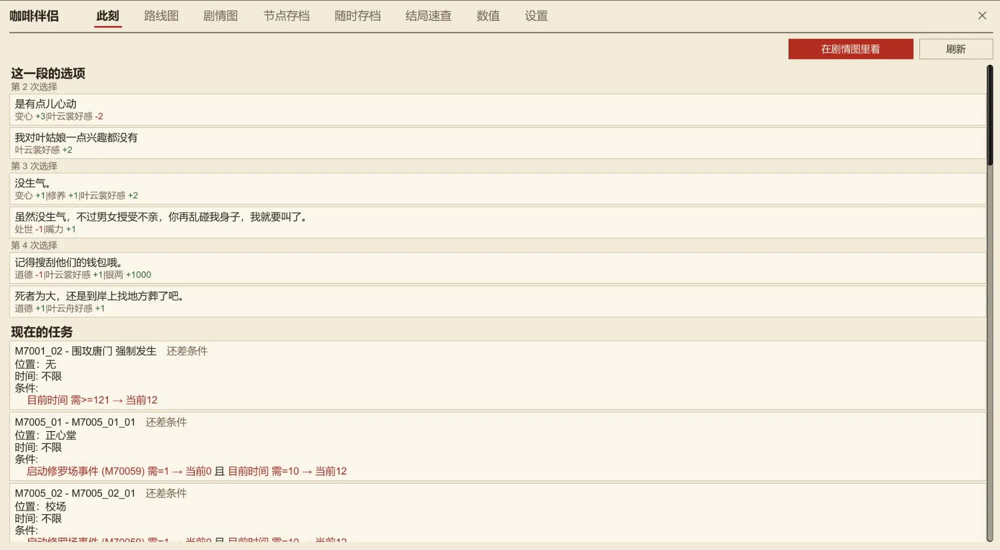
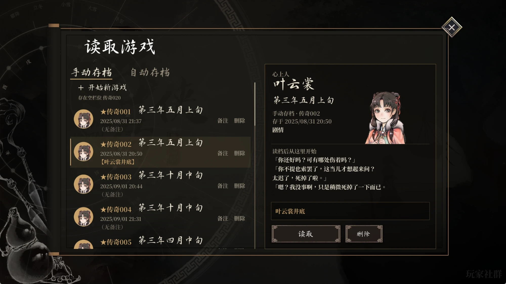
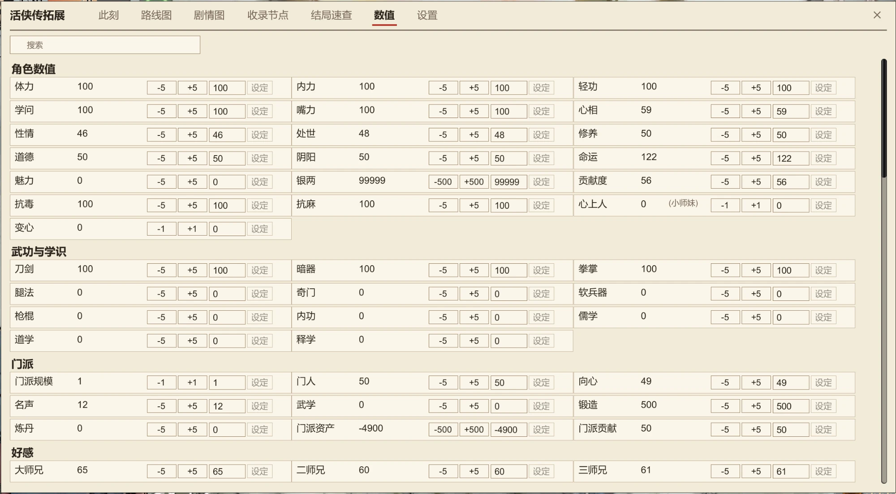
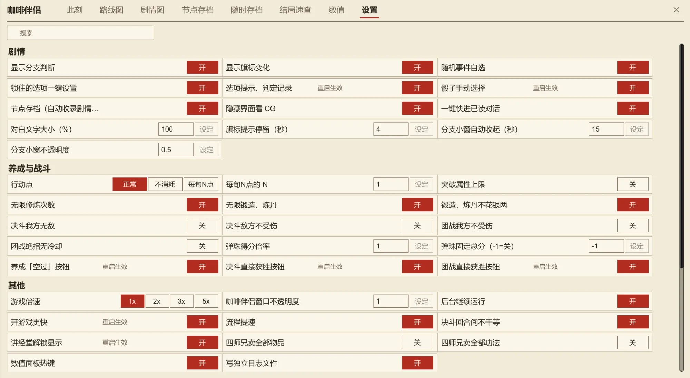

# Coffee Companion

[简体中文](README.md) · [繁體中文](README.zh-Hant.md) · **English** · [日本語](README.ja.md) · [한국어](README.ko.md)

A BepInEx 6 plugin for *Legend of Mortal* (活侠传). The name 咖啡伴侣 ("coffee companion") comes from 「咖啡」 (coffee), the players' nickname for the heroine 瑞杏 (Ruixing), whose name sounds like the Chinese coffee chain Luckin Coffee (瑞幸, Ruixing). It supports the latest version of the game and adds a story overview, branch picking, a stat editor, a better save/load screen, save-anywhere and more.

The mod's own windows are shown in Simplified Chinese, Traditional Chinese, Korean or Japanese (no English UI). Screenshots below are in Chinese.

[](https://github.com/kevinnie2003/LOMAssistant/releases/latest/download/LOMAssistant.zip) [![Nexus Mods](https://img.shields.io/badge/Nexus%20Mods-Download-D98F40?style=for-the-badge&labelColor=8A5A28&logo=data%3Aimage%2Fpng%3Bbase64%2CiVBORw0KGgoAAAANSUhEUgAAACAAAAAgCAYAAABzenr0AAAEXElEQVR4AazW7XkTOxAF4E0auaYSQiVAJQmVECrBVEJuJeG8Y42stR3yBz%2BalTQfZ45GWq3vt3%2F8e319PUQeI7%2BH%2FEz%2F8FaamwQSAOQh%2FVUgXUSC7%2BmBt5g%2FJtHvyFPkMARG%2B9BFfW47AgGU%2BGfMQPQCrUQvwWts9BJ8yRh4izl91LO9zNG28YNz2JbfJCB59BJzzHA2AXQSTOU7g6e70%2B9D%2FL5GmggsJOBFvW2TQGbfI90EHDN5jujTVWu9lX6KZhU69k%2FJ%2FS22ahnD4KenQ2LmKgJZPUWzKhCeCcaeCJYAEEKqYStWYf%2BaGHbhU6KDiRQceltd%2Be6T3AAgAwEi4GXYJBHMZosksgrzVcRdJQ%2BGZBYIZ42rsQp8XlBWEEkFqkAnXlx3w2NW2aubhiS3OIm32J2HH9M4BghwqmmcJkjGqmBeAOXw9gPZnXVJXrYx%2F7g4VbUQaJ2EPa4%2BJAQrec1vPBBcq1YuI1kTdzdYuWrOrQ525UOgBom0V9Mh82pxRMI21DwPSdNVO8S%2BzkuZh6Tpqtlr2wynFHnU6tPXa7ga3HAC2KaMJPYQkdX%2Fynesfm7rALlc2Iy7Dzg2vQqGLt2IPXXxe4k8R1Rs%2Bo%2BEJ6c8Y4fndc1s1%2F7LjC3dptpyVQUofnkMOQbU9Xu5imGuzp7WII86WIkBqoJ9Xce0a6pwVT1ngFeBGESAY%2BfuJ8ZRn9tYZa%2FmS5Kr2nuv6iVO5WwCZ%2FRtU%2BItPwFYu7v1UW1bktVKa3J68FurJR65v709IsXNLaBoKUNP0tc8iZXXKgnwy6R0vgMfUqFbZyBQu4boJFCTxWwFy3TzDktQZIZhF5Ok3yIzLmP77c2ZusSt8f9nPgnUhOIdkXT91Da4bVkrUjAh4c1RDeTFehPK1o8%2BA4yte8yggTOcTWLltbJWOrA9dtn0eNeHiBhE5lmKw%2FkQxkHCJqFMK3B8qz3lHLDVZDzEjeFWFYjPmmTrX3LAR6JV9ZevK9BKvSSqoGzmLb54QHruC2feJGyDOK%2FuzXtkkHCbwpDn80qAgqHF5dTgEnVg272SVts%2B9E0aFiII0a%2By%2Bj8UgYuyuWbtmZPfSX3xkJhAI4ZPJ522MUDCtu1IjCo01qEIJGA9nb%2BGEyJuOO%2F2yjru1XbApdk%2FJLGA2us2DeLIUT03AZOWj3GS%2BCFEnPqr5LFL3iAdt%2FZiHDhvhgOtUrZMTI2H849bBHzjrRrA8Dt3Se602%2Fuz8nR9W7HtEIeARdg6lWTjvyZ3qI9NAEsORMlWR7qSkRywMyKRErvt9BJZITsiYh4To1pW7wpHnr4vqNNNmFJjCISR%2BMJ5lWqlAelXDDg7gsZ6wMaSlj%2BHCDLm9BKbR11t5uoKeKetwGrKIw8BXiUJCKCo320WA%2BstR9tri8o%2BCZiNSiCxAiDC3IKIFRBjvnrAgbhzcNng9DaZOw93%2Bc3kAHcEKOJgfyogc%2BDpNquSBLivnr9mxBiwfgc8cI7p%2BZVsN35%2FAAAA%2F%2F8CpstnAAAABklEQVQDAC6567qqPgZJAAAAAElFTkSuQmCC)](https://www.nexusmods.com/legendofmortal/mods/10)

[](https://github.com/kevinnie2003/LOMAssistant/releases)

## Install

The zip already contains BepInEx.

**Installer (recommended)**: unzip and run `咖啡伴侣安装器 Installer.exe`, then click **Install / Update**. It finds the game folder, downloads the latest version (or installs the bundled one if GitHub is unreachable) and moves old mods known to conflict to `BepInEx\DisabledMods` (not deleted). Run it again to update. The installer follows your Windows display language.


**Manual**: in Steam, right-click *Legend of Mortal* → Manage → Browse local files, and extract everything in the zip into the game folder, overwriting files. Remove older mods of the same kind (骰子大师, 多功能 Mod, 赵活系统) from `BepInEx\plugins` first.

**Uninstall**: run the installer and click **Uninstall**. Saves are not touched.

## Hotkeys

| Key | Action |
|---|---|
| Tab | The 咖啡伴侣 window (now, route map, story map, branch saves, save-anywhere, endings, stats, settings) |
| F8 | Settings; on the save screen, edit the note of the selected save |
| F9 | Stats page |
| F5 / F7 / F6 | Save-anywhere: new save / load the latest / list all |
| F2 | Skip read dialogue until an unread line |
| F4 | Roll back to before the last story check |
| Right click | Hide the UI to view CGs |
| Gamepad L3 | Open / close the window |
| ESC | The game menu gets 「空过」 (skip turn), 「直接获胜」 (win now) and 「导出诊断」 (export diagnostics) |

All keys can be changed or unbound under 「热键」 (Hotkeys) on the settings page.

## Features

### Story overview (Tab)

- **Now**: every option and dice outcome of the current scene with its result, the branch conditions, whether the following dialogue has been read; the random events here with their odds (pick the next one); your current quests, where to trigger them and what is still missing.

  

- **Route map**: the whole main story laid out on a calendar, branches as separate lanes, side quests below; ticks mark what this playthrough has done. Click a stop for when, where and under which conditions it triggers. Search by quest, place, dialogue or flag (a flag result lists the scenes that change or check it).

  

- **Story map**: each quest as a flow chart, with the option or condition on every path.

  

- **Branch saves**: progress is recorded at quest starts and key options; click 「从这里重玩」 to go back and try another path. Separate per save, uses no save slots, synced with Steam Cloud.

  

- **Endings**: endings, deaths and achievements with their gallery numbers, what you have reached and how to reach the rest.

  

### Story helpers

- **Pick dice results**: click a line on the dice wheel to choose that result.
- **Option results**: dialogue options and dice lines show what they will change; locked options show their real unlock conditions, and 「一键设置」 next to them sets the conditions. 「选项后果」 in settings shows these always, only on hover (no spoilers unless you look), or never.

  

- **Pick random events** (off by default): when working, wandering and so on, choose which event triggers, or roll with the normal odds. Branch checks that roll a random number (such as being pulled into a run by 小梅 while training) also let you pick the path. Each event or path can be set to 「总是」 (always) or 「不出」 (never); the rule is remembered and applies even with the picker off.

  

- **Map event hints**: hover over a building on the training map to see its main and side quests (can they trigger, conditions) and the odds of its random events; buildings with a quest you can trigger now stay lit.
- **Branch panel** (off by default, spoilers): lists the conditions of each branch check on the left, met in green and unmet in red.

  

- **Flag change notices** (off by default, spoilers): a notice when the story changes a flag; how long it stays can be set.
- **Checks in the backlog**: story checks, their conditions and your values are recorded in the backlog.
- **Hide UI for CGs**: right-click in a story scene to leave only the background, CG and portraits; right-click again to restore.

### Saves

- **Save anywhere**: save during dialogue, options, dice rolls or on the training map, without using the game's slots. F5 saves, F7 loads the latest, F6 lists them all (notes, the dialogue at that point); up to 100 are kept. Not available in combat.
- **Roll back**: after seeing a check, press F4 to go back to the line before it, adjust stats with F9 and continue; the check is re-evaluated.

  

- **New save/load screen** (can switch back to the original): a list with your love interest's portrait, date and note, and a detail pane with their full portrait and the first lines after loading; manual and auto saves on separate pages. It opens on the save you made last; in settings, saves can be listed newest first.

  

- **More slots**: 100 manual saves (20 in the base game), 5 pages of legend slots (1 page of 12), and 5 extra old copies of each auto save.
- **Save notes**, synced with Steam Cloud; notes from LOM_SaveSlotExpander are imported.

### Training and combat

Switches in the training and combat groups of the settings page (F8):

- Game speed 1x / 2x / 3x / 5x
- Action points: normal / not consumed / N per period
  > ⚠️ The last two can make some story events not trigger or trigger early, and may block key main quests. Use with care and keep saves.
- Break the 100 stat cap, unlimited training, unlimited forging and alchemy at no cost
- Duel invincibility and no damage to enemies; no damage to your side and no ultimate cooldown in team battles
- Duel enemy forecast (off by default): shows the enemy's chosen move; the window can be moved and resized
- Pinball total score and multiplier; the fourth senior brother sells every item (off by default)

Also:

- **Skip turn**: in the ESC menu on the training and study maps; uses one action without triggering events.
- **Win now**: in the ESC menu during duels and team battles.
- **Speed-ups**: faster scene changes, loading and skipping, shorter pauses after stat changes, no idle wait between duel rounds.
- **Skill list columns**: in battle, a long skill list is split into columns.

### Stats page (F9)

Stats, martial arts, sects, relationships (everyone), talents, training and crafting points, facilities, books, items and flags on one page; add, subtract or set any value, and search by name, ID or description.

- **Books and items**: set the count directly; quests advance as if bought in a shop.
- Your **love interest** is shown by name; the **mood lock** keeps story and options from changing your mood.
- **Titles**: pick any title or write your own.
- **Flags**: over a thousand, grouped by sect favour, characters, story and more.
- **Reverse lookup**: click a flag, book or item to list the scenes that change or check it; click a name under relationships to list the scenes that check it. Each links to the story map.



Changing values or flags at random can break the story; save first.

### Other

- **Gamepad**: the whole window works with a gamepad (L3 opens it, the left stick moves the pointer, A clicks, LB / RB switch tabs); dice, skip turn and the event picker too.
- **Interface**: dark mode; Source Han Serif or Microsoft YaHei font; separate opacity for the main window, small windows and hint boxes; larger dialogue text.
- **Languages**: Simplified Chinese, Traditional Chinese and Korean following the game language, Japanese with the [Japanese patch](https://dlaqe2334.github.io/LOM-JPMOD/); can also be chosen in settings.
- **Export diagnostics**: ESC → 「环境设定」 → 「导出诊断」 packs logs and settings to the desktop (no saves); also in the installer.
- **Conflict detection**: warns about conflicting old mods at the top of settings; if another mod uses the same key, this mod gives it up.
- **Export legend**: export this playthrough's legend as a txt at any time from 「状态 → 传奇」.
- **Faster start**: the title animation is sped up, and the installer can skip the opening logos.
- **Also**: choose who appears on the title screen; the lecture hall shows everything unlocked; the game can keep running in the background (off by default); the window's top right shows each version's changes and a red note when a new version is out.

## FAQ

**Found a bug?** Run the installer again to make sure you are on the latest version. If it persists, export diagnostics and open an [issue](https://github.com/kevinnie2003/LOMAssistant/issues) describing how it happened.

**Nothing happens after installing?** Quit Steam completely from the tray and start the game again. If it still does not work, use **Export diagnostics** in the installer.

**Game in a folder with Chinese or other non-English characters?** BepInEx fails to load there. Move the game folder to a path with only English letters and numbers (in Steam, right-click the game → Properties → Installed Files → Move install folder), then run the installer again.

**Option results missing, dice cannot be picked?** An older mod of the same kind is installed. The installer handles this; for manual installs, remove the old mods from `BepInEx\plugins`.

**Works with 邪神认知污染ON and 剧情随行?** Yes. For 邪神认知污染ON install only 「1_必装_插件」, not 「2_只有没装过BepInEx才装」 (if you did, run this mod's installer again). Clashing hotkeys are given up automatically; bind another under 「热键」.

**Linux / Steam Deck?** Install manually and add `WINEDLLOVERRIDES="winhttp=n,b" %command%` to the Steam launch options.

## Settings

Everything is on the settings page of the window (F8). Changes are saved immediately; ones that need a restart are marked; hover over a name for details. Settings are also stored in `BepInEx\config\LOMAssistant.cfg`.



## Building

You need the .NET 8 SDK and a game folder with the mod installed (the build references the game's and BepInEx's assemblies; no game files are in this repository).

```bash
GAME="D:/Steam/steamapps/common/LegendOfMortal" DOTNET=/path/to/dotnet ./build.sh
DOTNET=/path/to/dotnet ./Installer/build-installer.sh
```

## Credits

See the [Chinese README](README.md#致谢). This project builds on 活侠传助手 by 爱死, and takes ideas or code from MortalAnytimeSave, 赵活系统 and LOM_SaveSlotExpander; legend slot pages follow the design in [iampigcheng](https://github.com/iampigcheng)'s [issue #21](https://github.com/kevinnie2003/LOMAssistant/issues/21). Thanks to [lxsb222-spec](https://github.com/lxsb222-spec), [blakceyes](https://github.com/blakceyes) and [NEXTAltair](https://github.com/NEXTAltair) for their pull requests.
