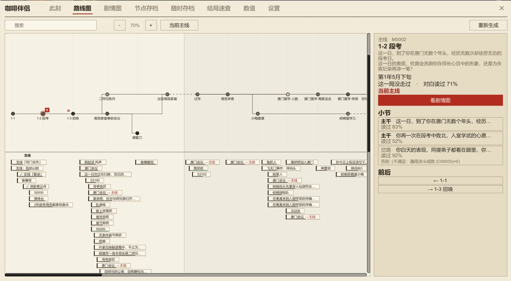
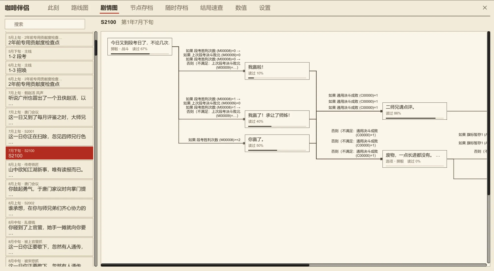
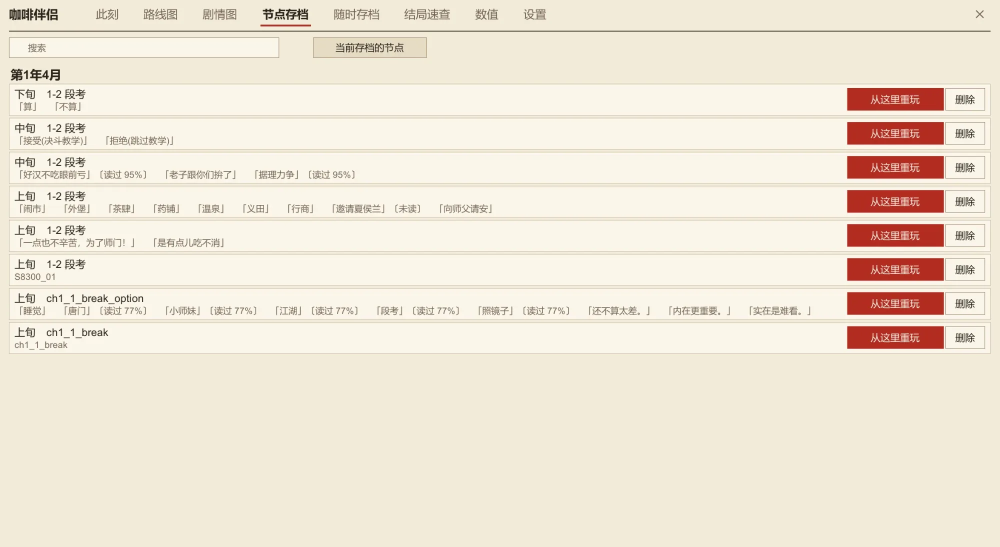
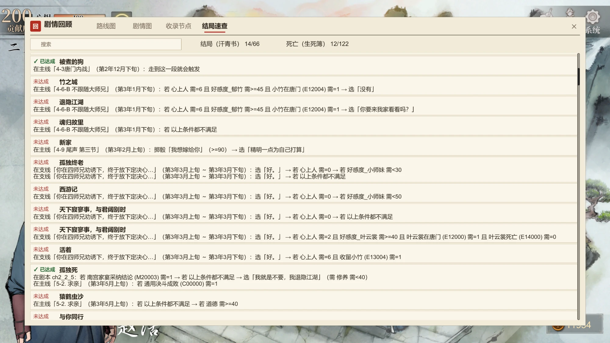
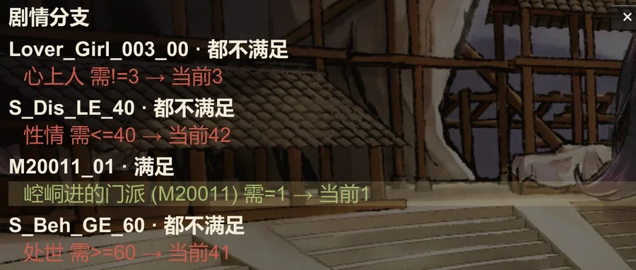
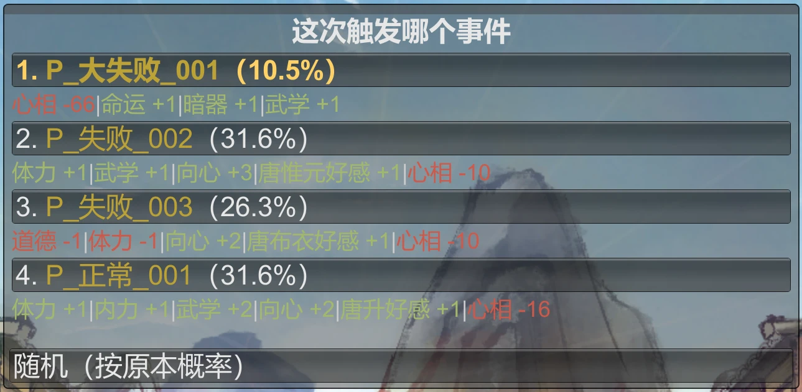
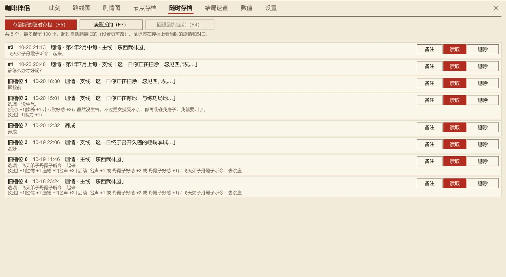
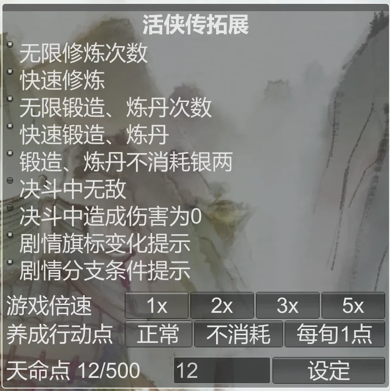
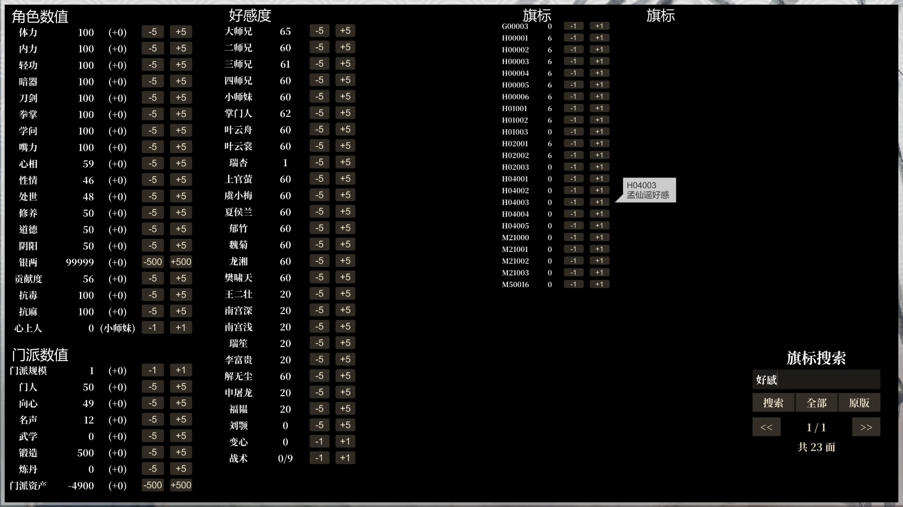

# 活侠传拓展

《活侠传》（Legend of Mortal）的 BepInEx 6 插件。适配最新版游戏，并加入剧情回顾、分支自选、修改面板、存档优化、随时存档等功能。

**[⬇ 下载最新版](https://github.com/kevinnie2003/LOMAssistant/releases/latest/download/LOMAssistant.zip)**　·　**[夸克网盘下载](https://pan.quark.cn/s/e78c41abcebc)**　·　**[▶ B 站演示视频](https://www.bilibili.com/video/BV1LZJh6YEUy/)**　·　**QQ 群：496887060**

## 安装

压缩包已包含 BepInEx，不用另外下载。

**一键安装（推荐）**：解压后双击 `活侠传拓展安装器.exe`，点「一键安装 / 更新」。

- 自动找到游戏目录，联网下载最新版（连不上 GitHub 就安装压缩包里自带的版本）。
- 已知会冲突的旧 Mod 移到 `BepInEx\已停用的Mod`，不删除；不改动你的设置。
- 以后更新再运行一次即可。Windows 提示「已保护你的电脑」时，点「更多信息」→「仍要运行」。

**手动安装**：Steam 中右键《活侠传》→ 管理 → 浏览本地文件，把压缩包里的所有内容解压到游戏目录，提示同名文件时选覆盖。先删掉 `BepInEx\plugins` 里的旧版骰子大师、多功能 Mod、赵活系统等同类 Mod，它们和本 Mod 改的是同一批游戏代码。

**卸载**：删除游戏目录下的 `winhttp.dll`。

## 快捷键

| 按键 | 功能 |
|---|---|
| F8 | 拓展面板（修炼、锻造、倍速、剧情提示等开关） |
| F5 / F7 | 随时存档：保存 / 读取当前槽位 |
| F6 | 随时存档面板（选槽位） |
| F4 | 回退到剧情判定前 |
| F9 | 数值面板（属性、好感、旗标） |
| Tab | 剧情回顾（路线图、剧情图、收录节点、结局速查） |
| ESC | 游戏菜单里加了「空过」「直接获胜」「导出诊断」 |

按键都可以在配置里改。

## 功能

### 剧情辅助

- **剧情回顾**（Tab）：看清整个游戏的剧情怎么走，还能回到之前的剧情重玩。分四页：
  - **路线图**：整个游戏的主线按时间从左到右排开，一站是一个主线任务。路线分岔的地方会分成上下几条线，支线列在下面。
    - 圆圈越黑，说明这段对白读得越多；打勾的是这一局走过的；盖红色「今」字的是你现在所在的主线。
    - 点一站，可以看它什么时候、在哪触发，需要什么条件（还会写出你现在的数值），以及站里有哪些岔路、怎么进去。
    - 搜索框能搜任务名、地点和台词，点搜索结果会跳到对应的剧情。
    - 按住鼠标拖动地图，Shift + 滚轮左右移动。

    

  - **剧情图**：选一个任务，把它的剧情画成流程图。每个方块是一段剧情，方块之间的线上写着要选哪个选项、满足什么条件才会走过去。点方块可以看去每个方向的条件，以及路上属性会怎么变。

    

  - **收录节点**：剧情走到关键的地方（任务、事件的开头，或者会通向不同剧情、结局的选项）时，自动存下这段剧情开头的进度。
    - 点「从这里重玩」并确认，就能回到那段剧情的开头重新玩，想试另一条路很方便。
    - 每个存档各收录各的，不同存档、不同路线互不干扰；不占用、也不改动你的手动存档。
    - 这些进度放在游戏存档文件夹里（`LOMStory_` 开头），会跟着 Steam 云同步；不想要了，删掉这些文件就行。

    

  - **结局速查**：列出所有结局和死亡，哪些已经达成过，没达成的要怎么走到。

    

  - 路线图、剧情图、结局速查第一次打开时要读一遍全部剧本，需要等几秒。

- **分支自选**：掷骰判定时，点击任意一条线路直接选中那个结果，不用碰运气。不点直接按开始仍是随机。
- **选项结果**：对话选项后面直接显示选了会有什么变化。

  

- **选项解锁条件**：被锁住的选项（「解锁条件：？？？」「银两不足」这类）显示真正的解锁条件和当前值；满足条件就接一段剧情的选项，括号里写「若 条件：触发剧情」。
- **一键设置**（F8 可关，默认开）：被锁住的选项旁有「一键设置」，把没满足的解锁条件直接改到满足，选项当场解锁。
- **剧情分支小窗**（F8 开启，默认关，可能剧透）：剧情走到分支判断时，屏幕左侧列出各分支条件，满足为绿、不满足为红，实际走的那行高亮。小窗可拖动、可关闭，15 秒没有新判断自动收起。

  

- **右键隐藏界面看 CG**（默认开，配置 `EnableRightClickHideUI` 可关）：剧情里按鼠标右键，对话框、标题等文字界面和本 Mod 的窗口都藏起来，只留背景、CG 和立绘，方便截图；再按一次右键恢复。也可以在配置 `HideUIKey` 绑一个热键。
- **回想里的判定记录**：剧情经过的判定点、触发条件和当前值会记进回想（对话记录）里，可以翻回去看。
- **随机事件自选**（F8 开启，默认关）：工作、闲逛这类随机事件，剧情走到抽事件那一步时先停下，列出这次满足条件的事件和各自概率、会带来的变化，选一个就触发它，也可以选「随机」按原本概率抽。只有一个能触发时不停。可以用鼠标点，也可以用方向键、数字键、回车或手柄十字键加确认键。

  

- **地点事件提示**：养成地图上鼠标停在建筑上，主角会提示点这里会触发哪个任务。
- **旗标变化提示**（F8 开启，默认关，可能剧透）：剧情改动旗标时在屏幕上提示，如「【旗标】神兵帖进度 1 → 2」。

### 存档

- **随时存档**：剧情的台词、选项、掷骰时，以及养成界面，都能存档。存在独立的 8 个槽位（存档目录下的 `AnytimeSave`），不占原版存档栏。F6 打开面板选槽位，F5 保存，F7 读取；在标题界面也能读。读剧情档时会快进到存档的那一句，等几秒即可。不能在战斗中存档。
- **回退到判定前**：剧情里每次分支判断、条件检查、掷骰判定时，自动记下它前一句台词或选项。看到判定条件后按 F4 回到那一句，用 F8 / F9 调好数值再往下点，判定会按新数值重新计算；连按继续往前退，最多保留最近 3 个判定点。只存在内存里，切场景、进战斗后清空。

  

- **手动存档 100 个栏位**（原版 20 个）。
- **存档备注**：存档、读档界面按 F8 给所选存档写备注，显示在存档栏下方，随 Steam 云存档同步。从 LOM_SaveSlotExpander 换过来的会自动导入原来的备注。
- **自动存档历史**：养成、剧情、战斗三类自动存档各多留 5 个旧档，读档界面自动存档卡片右侧的 ▲ / ▼ 可以切换。

### 养成与战斗

- **F8 拓展面板**：
  - 无限修炼次数、快速修炼（投 1 点直接升级）
  - 无限锻造、炼丹次数，快速锻造、炼丹，不消耗银两
  - 决斗中无敌、决斗中造成伤害为 0
  - 游戏倍速 1x / 2x / 3x / 5x
  - 设定天命点
  - 弹珠小游戏里直接设定总分、得分倍率

  

- **空过**：养成界面、留学地图按 ESC，菜单里有「空过」，消耗 1 次行动、不触发任何事件。
- **直接获胜**：决斗、团战中按 ESC，菜单里有「直接获胜」。
- **流程提速**：切场景、读档、快进剧情更快，回想（对话记录）不再每句话重排一次；数值变化后的停顿从 0.5 秒缩到 0.2 秒，没显示的变化不停顿；养成地图上行动后的等待和转场快 3 倍。
- **开游戏更快**（默认开，配置 `EnableFastStartup` 可关）：标题画面「启程」等按钮浮现的开场动画加快 6 倍。开头的两张 Logo 由安装器跳过（勾选「跳过游戏开头Logo」，默认勾选；它会改游戏设置文件里的一个开关，原文件备份为 `globalgamemanagers.lom-original`，游戏更新或 Steam 验证文件后重新运行一次安装器即可）。
- **决斗回合间等待缩短**：身上状态（buff）越多，回合之间原本要干等越久；现在空等的步骤直接跳过，效果、数值和结算顺序不变。
- **养成行动点**（F8）：正常 / 不消耗 / 每旬 1 点。不消耗时行动点扣到 1 不再扣，用「空过」结束本旬；每旬 1 点时每旬只能行动一次。
  > ⚠️ 这两个模式可能让部分剧情不触发或提前触发，还可能有 bug 卡掉关键主线，后面的剧情接不上，整个存档等于废了。我们一直在测试和修复，但不能保证完全没问题，请谨慎使用，多存档。
- **四师兄售卖全部物品**（默认关，配置 `EnableShopAllItems` 打开）：商店里加入所有没拥有的书籍、杂物、特殊物品；不卖《证类本草》（提前买会导致六月后山事件出 bug）。
- **四师兄售卖全部书籍**（默认关，配置 `EnableShopAllBooks` 打开）：只加书，不加杂物和特殊物品。各门派、线路限定、平时买不到的功法秘笈都能买，没拥有的才卖，不卖《证类本草》和剧情里拿不到的三本书（松风剑法、天师剑法、四平枪谱）。
- **讲经堂**：全部解锁显示。

### F9 数值面板

游戏内置的测试面板，可直接加减属性、好感度、门派数值、旗标。本 Mod 改为简体，并加了：

- **旗标搜索**：面板底部搜索栏按旗标名或中文备注搜（如「孟仙谣」「好感」「神兵帖」），能找到全部一千多面旗标，原版只能看到 51 面。「全部」列出所有旗标，「原版」恢复原来的列表。
- **武学点、变心、战术**：属性列锻造上面多了一行武学点；好感度列下面多了变心和战术天赋等级。



乱改数值、旗标可能让剧情出错，改之前先存档。

### 其他

- **手柄支持**：骰子选线（十字键或左摇杆切换，A 确认）、空过、直接获胜。
- **导出诊断**：游戏 ESC →「环境设定」→「导出诊断」，把日志、配置、插件列表打包到桌面（不含存档）。安装器里也有同样的按钮，Mod 没加载时用它，还会检查 BepInEx 是否完整。
- **冲突检测**：装了会冲突的旧 Mod 时，启动几秒后自动弹出 F8 面板，用红字提示是哪个。
- **全部简体显示**：选项结果、事件名、旗标名等游戏数据都转成简体。
- **防误触**：点 Mod 的窗口时不会点到下面的游戏界面，在 Mod 的输入框里打字也不会触发游戏快捷键。

## 常见问题

**遇到 bug 怎么办？** 先重新运行一次安装器，确认已是最新版。还有问题的话，用「导出诊断」把桌面上生成的压缩包发到 QQ 群或 [Issues](https://github.com/kevinnie2003/LOMAssistant/issues)，并说明是怎么出现的。

**装了没反应？** 从托盘完全退出 Steam 再打开游戏。还不行就用安装器里的「导出诊断」看看缺了什么。

**选项结果不显示、骰子不能自选？** 和旧版骰子大师、多功能 Mod 冲突，用安装器会自动处理，手动安装请删掉 `BepInEx\plugins` 里的旧 Mod。

**Linux / Steam Deck？** 手动安装后，在 Steam 启动选项里加 `WINEDLLOVERRIDES="winhttp=n,b" %command%`。

## 设置

常用开关都在 F8 面板里。其余设置在首次启动后生成的 `BepInEx\config\LOMAssistant.cfg` 中，每项都有中文说明，改完重启游戏生效。

## 开发

想自己改代码、或者想确认安装包和源码一致的话，可以自己编译。需要 .NET 8 SDK 和装好本 Mod 的游戏目录（编译时直接引用游戏和 BepInEx 的程序集，仓库里没有任何游戏文件）：

编译 Mod（会直接装进游戏目录）：

```bash
GAME="D:/Steam/steamapps/common/LegendOfMortal" DOTNET=/path/to/dotnet ./build.sh
```

编译一键安装器：

```bash
DOTNET=/path/to/dotnet ./Installer/build-installer.sh
```

| 目录 | 内容 |
|---|---|
| `LOMAssistant/` | 插件入口、日志、诊断、选项提示等 |
| `LOMAssistant.Config/` | 配置项 |
| `LOMAssistant.Features.*` | 各功能（`Extras` 是本项目新增的，`AnytimeSave` 是随时存档） |
| `Installer/` | 一键安装器 |
| `tools/anytime-contract/` | 游戏更新后重新生成随时存档的兼容契约 |
| `tools/bepinex-patch/` | 给打包的 BepInEx 打补丁：修复游戏装在中文路径下 BepInEx 启动失败 |

## 致谢

本项目不是从零开发的，功能思路和部分代码来自以下作者：

- **[活侠传助手](https://mod.3dmgame.com/mod/256420)**：爱死（3DM：wowowo4567）。本项目的基础，源码由其发布的插件反编译而来后再修改。它又整合自 [骰子大师](https://mod.3dmgame.com/mod/210536)（Gmhaxx）、[多功能 Mod](https://mod.3dmgame.com/mod/210629)（Jim97）、[任意位置存档](https://mod.3dmgame.com/mod/210679)（NothingNullNull）。
- **随时存档**：移植自 mahosalieri85-a11y 的 MortalAnytimeSave（[issue #2](https://github.com/kevinnie2003/LOMAssistant/issues/2)）。
- **剧情分支小窗、选项提示、输入隔离、随机事件自选、一键设置、流程提速、决斗回合间等待缩短、剧情回顾**：参考 [赵活系统](https://github.com/Toufff/zhaohuo-system)（Toufff，MIT 许可）的功能思路。
- **存档备注显示**：移植自 [LOM_SaveSlotExpander](https://gitlab.com/ame-chan/lom_saveslotexpander)（ame-chan，MIT 许可）及其[汉化版](https://github.com/shiluodeqiou/LOM_SaveSlotExpander-zh)（shiluodeqiou）。
- **修炼、锻造、炼丹**：参考风灵月影《活侠传》修改器的功能思路（未使用其代码）。
- 下载包附带的 [BepInEx](https://github.com/BepInEx/BepInEx)、[UnityDoorstop](https://github.com/NeighTools/UnityDoorstop)、[Newtonsoft.Json](https://github.com/JamesNK/Newtonsoft.Json) 按各自的许可证分发。

也推荐 xiaozhanshang 的 [剧情随行](https://github.com/xiaozhanshang/MortalStoryWorkbench)，可以和本 Mod 同时安装：两边重叠的功能自动用本 Mod 的，它的快捷键改成 Ctrl+F6 / F8 / F9。
